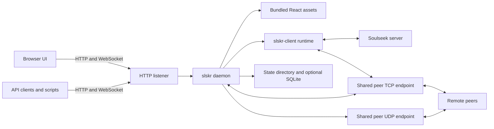

# slskR

[](https://github.com/snapetech-org/slskr/releases)
[](./LICENSE)
[](https://github.com/snapetech-org/slskr/pkgs/container/slskr)
[](https://discord.gg/5PyXBfvS6T)

**A self-hosted Rust Soulseek daemon, HTTP API, and bundled browser UI — one process, one config file, one state directory.**

slskR is a native Rust client for the [Soulseek](https://www.slsknet.org/news/) network. One `slskr serve` process owns the Soulseek session, peer listeners, share index, transfer engine, HTTP API, event stream, and the bundled React Web UI. It is built for operators who want a private, scriptable, low-footprint Soulseek client they can run on a laptop, a home server, or a container platform — and for automation authors who want a stable HTTP contract with typed clients in several languages.

slskR pursues behavioral compatibility with useful slskd/slskdN workflows, but it is an independent Rust implementation with its own configuration and release contracts. It is not a fork, wrapper, or source-lineage port.

## Table Of Contents

- [Screenshots](#screenshots)
- [Highlights](#highlights)
- [Features](#features)
  - [Soulseek client](#soulseek-client)
  - [Web UI and media workflows](#web-ui-and-media-workflows)
  - [Transfers and content discovery](#transfers-and-content-discovery)
  - [Shares and browse](#shares-and-browse)
  - [Messaging, rooms, and users](#messaging-rooms-and-users)
  - [API and automation](#api-and-automation)
  - [Integrations](#integrations)
  - [Mesh, DHT, and pods](#mesh-dht-and-pods)
  - [Localization](#localization)
- [Quick Start](#quick-start)
  - [Docker](#docker)
  - [Release binary](#release-binary)
  - [Build from source](#build-from-source)
  - [First run](#first-run)
- [Installation](#installation)
  - [Package and container channels](#package-and-container-channels)
  - [Unraid, TrueNAS, and Synology](#unraid-truenas-and-synology)
- [Configuration](#configuration)
  - [Paths](#paths)
  - [Common environment variables](#common-environment-variables)
  - [Credential storage](#credential-storage)
  - [Network ports](#network-ports)
- [Security](#security)
- [HTTP API And Clients](#http-api-and-clients)
  - [Quick API examples](#quick-api-examples)
  - [API surface](#api-surface)
  - [Client libraries](#client-libraries)
  - [Webhooks](#webhooks)
  - [Events and metrics](#events-and-metrics)
- [Deployment](#deployment)
  - [Docker Compose](#docker-compose)
  - [systemd](#systemd)
  - [Kubernetes](#kubernetes)
  - [Reverse proxy](#reverse-proxy)
- [Performance](#performance)
- [CLI Reference](#cli-reference)
- [Testing And Verification](#testing-and-verification)
- [Architecture](#architecture)
- [Documentation](#documentation)
- [Support](#support)
- [License](#license)

## Screenshots

The README screenshots are generated from the local Web UI with mocked daemon responses, so they do not contain credentials or local file paths.

| Search and discovery | Transfers |
| --- | --- |
|  |  |

| Rooms and messaging | System status |
| --- | --- |
|  |  |

Regenerate them from a running frontend:

```bash
cd web
SLSKR_SCREENSHOT_BASE_URL=http://127.0.0.1:3001 \
  node scripts/capture-readme-screenshots.mjs
```

## Highlights

- **One binary, one process.** The daemon, HTTP API, event feed, and Web UI ship together. No sidecar, database server, or external web host is required.
- **Low idle footprint.** A measured matched-disconnected run put slskR at roughly 0.03% of one logical CPU and 21–25 MiB summed RSS versus slskd 0.26.1 at 0.49% and 130–219 MiB. See [Performance](#performance) for method and limits.
- **API-first.** Versioned `/api/v0/*` routes, an OpenAPI contract, a WebSocket event feed, webhooks, and TypeScript, Python, and Go clients.
- **Conservative defaults.** Loopback-only HTTP, authentication required by default, CSRF checks on mutating browser requests, virtual share paths, and no credentials in sanitized responses.
- **Flexible credential storage.** OS keyring, systemd credentials, process memory, a restricted local file, or environment/config secrets for containers and secret managers.
- **Cross-platform releases.** Linux x86-64 and AArch64 (GNU and static musl), macOS Intel and Apple silicon, and Windows x86-64, plus a multi-arch `linux/amd64` + `linux/arm64` container image.
- **Broad packaging.** GHCR, Docker Hub, AUR, COPR, Launchpad PPA, Homebrew, Snap, Flatpak, Helm, TrueNAS, Unraid, Synology, Winget, Chocolatey, and Nix.

## Features

For the product-level map, see [docs/FEATURES.md](./docs/FEATURES.md). For which surfaces need configuration or external services, see [docs/status.md](./docs/status.md).

### Soulseek client

- Connect to a Soulseek account, maintain session state, reconnect, and report listener status.
- Search globally, for a user, or in a room; review results and browse a peer's shared files.
- Share configured local folders through a bounded index with filters and virtual paths.
- Queue and track downloads and uploads, including progress, cancellation, retries, and failure state.
- Exchange private messages, join rooms, watch users, and manage contacts and notes.
- Use direct, indirect, and type-1 obfuscated peer paths where the peer and network support them.

### Web UI and media workflows

`slskr serve` hosts the API, event stream, and bundled React UI on one listener. The UI covers search, downloads, uploads, rooms and messages, users, contacts, browse, shares, collections, share groups, integrations, player controls, system status, telemetry, and logs. Media and discovery surfaces include local and peer previews, library and source views, recommendations, metadata-assisted searches, and listening-party workflows; their availability depends on local data, peer availability, and configured integrations. See [web/README.md](./web/README.md) and [docs/app-surface.md](./docs/app-surface.md).

### Transfers and content discovery

Downloads and uploads are daemon-owned transfer records with queue, start, progress, completion, cancellation, retry, and failure state. slskR supports local file-backed projections, outbound downloads, inbound shared-file serving, direct peer transfer sockets, type-1 obfuscated transfers, indirect fallback, offset/resume, and bounded transfer history.

Explicit accelerated downloads can use `POST /api/v0/multisource/swarm` (or `/swarm/async`) with two or more HTTP range-capable sources and an expected SHA-256 digest. The daemon assigns bounded chunks, retries failed chunks elsewhere, verifies the result, and atomically publishes the confined output. Ordinary Soulseek peers remain sequential because the network has no harmless bounded range-cancellation primitive.

Short-lived peer and mesh preview tickets stream audio to the browser without creating a normal download. Peer previews negotiate Soulseek directly and do not write a local file. Mesh previews redeem a hash-pinned HTTP range source; bytes are exposed only after exact-size and SHA-256 verification, and the staging file is removed immediately afterward.

### Shares and browse

Share roots are indexed at startup or by rescan. The catalog uses virtual share paths rather than exposing raw host paths. Operators can configure hidden-file handling, symlink following, scan limits, filters, and allowed transfer directions. Browse state is tracked per peer and exposed through the API and UI.

### Messaging, rooms, and users

The daemon tracks private-message conversations and acknowledgements, room lists, join/leave state, recent room messages, watched users, user stats, contacts, notes, and the peer context used by search and browse workflows.

### API and automation

The HTTP API exposes versioned `/api/v0/*` routes plus selected compatibility aliases. Clients can authenticate with a bearer token or the `X-API-Key` header. Event consumers can poll bounded records or subscribe to the WebSocket stream. See [docs/http-api.md](./docs/http-api.md), [docs/http-api-features.md](./docs/http-api-features.md), and the machine-readable [OpenAPI document](./docs/openapi.json).

### Integrations

- **Spotify**: OAuth callback on the existing HTTP listener, with daemon-issued single-use state.
- **Lidarr**: status, wanted-item, and manual-import workflows using Lidarr's API key.
- **Visualizer**: optional local launch command with event recording.
- Other library, source, and recommendation views report unavailable or disabled states when their configuration or data is missing.

Setup is documented in the [install runbook](./docs/install.md#third-party-integrations).

### Mesh, DHT, and pods

The native/current runtime includes Mainline DHT rendezvous, TLS mesh transport, QUIC control/data paths, private service gateway support, and selected Pod services. The default peer-facing layout shares one numeric port across peer TCP and DHT/mesh/QUIC UDP traffic. Mesh services require reachable peers and, for trusted content sources, operator-pinned peer identity and endpoint data.

Gold Star Club membership is opt-in in ordinary native/current operation, and leaving is a permanent local opt-out. Read [docs/gold-star-club.md](./docs/gold-star-club.md) before enabling it.

### Localization

The shipped UI includes a browser-local interface-language selector for twelve locales (Spanish, Simplified Chinese, Hindi, German, Japanese, French, Brazilian Portuguese, Arabic, Korean, Traditional Chinese, Vietnamese, and Indonesian), with English fallback, placeholder parity checks, and locale-aware date, number, and byte formatting. Media titles, usernames, filenames, and API/protocol values remain unchanged. See [docs/localization-roadmap.md](./docs/localization-roadmap.md).

## Quick Start

### Docker

The container image is published for `linux/amd64` and `linux/arm64`:

```bash
SLSKR_API_TOKEN="$(openssl rand -hex 32)"
SLSKD_PASSWORD="$(openssl rand -hex 16)"

docker run -d --name slskr --restart unless-stopped \
  -p 5030:5030 \
  -p 2234:2234/tcp -p 2234:2234/udp \
  -e SLSKR_API_TOKEN="$SLSKR_API_TOKEN" \
  -e SLSKD_PASSWORD="$SLSKD_PASSWORD" \
  -v slskr-state:/var/lib/slskr \
  ghcr.io/snapetech/slskr:latest

printf 'Web login: slskr / %s\nAPI token: %s\n' "$SLSKD_PASSWORD" "$SLSKR_API_TOKEN"
```

Open <http://localhost:5030/>, sign in as `slskr` with the generated `SLSKD_PASSWORD`, then enter your Soulseek credentials. Use `SLSKR_API_TOKEN` for API clients. The container binds `0.0.0.0`, so authentication is required; always set a strong web password and API token. The image runs as UID/GID `1000` and stores state under `/var/lib/slskr`; bind-mounted share and download directories must be readable (shares) or writable (downloads/incomplete) by that user. Downloads default to `/var/lib/slskr/downloads` and incomplete files to `/var/lib/slskr/incomplete`; override them with `SLSKR_DOWNLOADS_DIR` and `SLSKR_INCOMPLETE_DIR`.

The peer port in the example is `2234` (the supplied example config). The native/current default peer port is `50300`; set `[network].listen_port` or `SLSK_LISTEN_PORT` and forward that number for both TCP and UDP.

### Release binary

Download the archive for your platform from [GitHub Releases](https://github.com/snapetech-org/slskr/releases):

| Platform | Archive |
| --- | --- |
| Linux x86-64 (glibc) | `slskr-<version>-x86_64-unknown-linux-gnu.tar.gz` |
| Linux x86-64 (static musl) | `slskr-<version>-x86_64-unknown-linux-musl.tar.gz` |
| Linux AArch64 (glibc) | `slskr-<version>-aarch64-unknown-linux-gnu.tar.gz` |
| Linux AArch64 (static musl) | `slskr-<version>-aarch64-unknown-linux-musl.tar.gz` |
| macOS Intel | `slskr-<version>-x86_64-apple-darwin.tar.gz` |
| macOS Apple silicon | `slskr-<version>-aarch64-apple-darwin.tar.gz` |
| Windows x86-64 | `slskr-<version>-x86_64-pc-windows-msvc.zip` |

Each archive includes the binary, the built Web UI, `README.md`, `LICENSE`, `NOTICE`, `COMPLIANCE.md`, the annotated config example, and `RUN.txt`. Verify the download against `SHA256SUMS.txt`, extract it, and put `slskr` on your `PATH`:

```bash
tar -xzf slskr-<version>-<target>.tar.gz
sudo install -Dm755 slskr /usr/local/bin/slskr
slskr version
```

On Linux, the release installer selects the GNU archive for your architecture:

```bash
packaging/linux/install-from-release.sh
```

### Build from source

Prerequisites:

- A Rust toolchain compatible with the workspace `rust-version`.
- Node.js/npm for the Web UI assets.
- Soulseek credentials for real network operation.
- Optional Go and Python for the client-library test gates.

Build the daemon and the production UI:

```bash
npm --prefix web ci
npm --prefix web run build
cargo build --release -p slskr
```

Install the binary and UI assets for a user-local install:

```bash
install -Dm755 target/release/slskr "$HOME/.local/bin/slskr"
mkdir -p "$HOME/.local/share/slskr/web"
cp -R web/build "$HOME/.local/share/slskr/web/build"
```

`slskr serve` looks for the production UI in `SLSKR_WEB_BUILD_DIR`, next to the binary as `web/build`, under `$prefix/share/slskr/web/build`, or in the current checkout. `/` is the full React client when those assets are present. A minimal built-in operator dashboard is available at `/dashboard`; if no built UI is present, `/` falls back to it and explains how to install the full UI.

### First run

```bash
slskr serve
```

Open <http://127.0.0.1:5030/>. The HTTP listener is loopback-only by default. Sign in with the web UI credentials (default username `slskr`, default password `slskr`; set `[auth].username`/`[auth].password` or `SLSKD_USERNAME`/`SLSKD_PASSWORD` to change them). On first connect, the UI prompts for Soulseek credentials and lets you choose runtime-only memory, the platform OS credential store, or a restricted local credential file. For a service, systemd credentials or a secret manager can supply credentials without a plaintext config file.

To connect automatically after restart, set `[app].auto_connect = true` or `SLSKR_AUTO_CONNECT=true`. Set share roots in `[shares].dirs` or `SLSKR_SHARE_DIRS` (semicolon-separated). The service account must be able to read those directories; slskR publishes virtual share paths and does not expose host absolute paths.

For the guided path from install to first search, see [docs/getting-started.md](./docs/getting-started.md).

## Installation

### Package and container channels

The release workflow publishes or prepares the following channels. Credentialed channels are skipped when their secrets are unavailable; GHCR is required. See [docs/dev/release-channels.md](./docs/dev/release-channels.md) for exact targets, credentials, and publication boundaries.

| Channel | Package / target |
| --- | --- |
| GitHub Container Registry | `ghcr.io/snapetech/slskr` (`linux/amd64`, `linux/arm64`) |
| Docker Hub | `snapetech/slskr` (best-effort mirror) |
| AUR | `slskr` (source), `slskr-bin` (binary) |
| COPR | `slskdn/slskr` (x86_64, aarch64) |
| Launchpad PPA | `~keefshape/ubuntu/slskdn` (amd64; arm64 source-ready) |
| Homebrew | `snapetech/homebrew-slskdn` compatibility tap |
| Snap | `slskr` (amd64, arm64) |
| Flatpak | `io.github.slskd.slskr` (x86_64, aarch64) |
| Helm | [packaging/helm/slskr](./packaging/helm/slskr) |
| TrueNAS SCALE | [packaging/truenas-scale/charts/slskr](./packaging/truenas-scale/charts/slskr) |
| Unraid | [slskr.xml](./slskr.xml) (Community Apps template) |
| Synology SPK | [packaging/synology-spk](./packaging/synology-spk) |
| Winget | `snapetech.slskr` (Windows x64) |
| Chocolatey | `slskr` (Windows x64) |
| Nix | `flake.nix` |

Container images:

```bash
docker pull ghcr.io/snapetech/slskr:latest
docker pull snapetech/slskr:latest
```

### Unraid, TrueNAS, and Synology

- **Unraid**: the Community Apps template lives at the repository root as [`slskr.xml`](./slskr.xml) and tracks the floating `latest` GHCR tag so catalog installs always pull the newest published release. The repository is submitted to the external Community Apps catalog at <https://ca.unraid.net/submit>; catalog review and listing are external.
- **TrueNAS SCALE**: install the chart from [packaging/truenas-scale](./packaging/truenas-scale).
- **Synology**: build the SPK from [packaging/synology-spk](./packaging/synology-spk) for x86_64 or aarch64.

## Configuration

### Paths

| Purpose | Default | Override |
| --- | --- | --- |
| Config file | `$XDG_CONFIG_HOME/slskr/config.toml` (fallback `$HOME/.config/slskr/config.toml`) | `SLSKR_CONFIG` |
| State directory | `$XDG_STATE_HOME/slskr` (fallback `$HOME/.local/state/slskr`) | `SLSKR_STATE_DIR` |
| Downloads | `$STATE_DIR/downloads` | `SLSKR_DOWNLOADS_DIR` |
| Incomplete | `$STATE_DIR/incomplete` | `SLSKR_INCOMPLETE_DIR` |

On Unix, the state directory must be a real directory, not a symlink, and slskR tightens it to mode `0700` because it contains messages, transfer state, share indexes, SQLite data, and durable mesh identity.

The authoritative option list is the annotated [config example](./docs/slskr.config.example.toml). The [configuration guide](./docs/configuration.md) explains sources, native/current network defaults, credentials, and optional features.

### Common environment variables

| Variable | Purpose |
| --- | --- |
| `SLSKR_HTTP_BIND` | HTTP listener; default `127.0.0.1:5030`. |
| `SLSKR_AUTO_CONNECT` | Connect at startup when credentials are configured or stored. |
| `SLSKR_CREDENTIAL_STORE` | Soulseek credential store: `os`, `systemd`, `memory`, or `file`. |
| `SLSKR_CREDENTIAL_FILE` | Local credential-file fallback path (default under the state directory). |
| `SLSKD_USERNAME`, `SLSKD_PASSWORD` | Web UI login credentials; default username `slskr`, default password `slskr`. Change these before exposing the daemon. |
| `SLSK_USERNAME`, `SLSK_PASSWORD` | Soulseek account credentials for env/config secret-manager deployments. |
| `SLSKR_API_TOKEN` | Administrator token for protected API routes. |
| `SLSKR_API_READ_WRITE_TOKEN` | Optional non-administrator read/write token. |
| `SLSKR_API_READ_ONLY_TOKEN` | Optional read-only token. |
| `SLSKR_API_NOWPLAYING_TOKEN` | Optional token restricted to the scoped now-playing webhook. |
| `SLSKR_AUTH_DISABLED` | Explicitly disable API auth (not recommended on exposed binds). |
| `SLSKR_SHARE_DIRS` | Semicolon-separated share roots. |
| `SLSK_LISTEN_PORT` | Peer listener port. |
| `SLSKR_LISTENER_BIND` | Regular peer listener bind address. |
| `SLSKR_ADVERTISED_PORT` | Public peer port advertised to the network. |
| `SLSKR_TRANSFER_MAX_ACTIVE` | Combined active upload/download cap. |
| `SLSKR_TRANSFER_ALLOW_INBOUND` | Enable inbound shared-file serving. |
| `SLSKR_TRANSFER_ALLOW_OUTBOUND` | Enable outbound downloads. |
| `SLSKR_TRANSFER_AUTO_RETRY_ENABLED` | Retry aged failed audio downloads (default `true`). |
| `SLSKR_DOWNLOAD_COMPLETED_PATH_TEMPLATE` | Confined download layout using `{uploader}`, `{remote_folder}`, `{remote_parent}`, `{remote_filename}`, `{batch_id}`, `{request_name}`, and `{date}` tokens. |
| `SLSKR_PERSISTENCE_ENABLED` | Enable SQLite-backed persistence (default off). |
| `SLSKR_LOG_LEVEL` | Runtime log threshold: `trace`, `debug`, `info`, `warn`, `error`. |
| `SLSKR_TRUSTED_PROXY_CIDRS` | Trusted reverse-proxy CIDRs for forwarded headers. |

The System → Logs tab can inspect recent logs and change the runtime log level without a restart. `RUST_LOG` is accepted as a familiar alias; `SLSKR_LOG_LEVEL` takes precedence.

### Credential storage

Credential source priority is: credentials supplied with a Web UI connect request, then configured environment/TOML credentials, then the configured `credential_store`.

| Mode | Best for | Persistence | Notes |
| --- | --- | --- | --- |
| `os` | Desktop and per-user services | Platform keyring | Recommended for interactive installs. |
| `systemd` | Linux system services | systemd credential manager | Read-only inside the daemon; configure in the unit. |
| `memory` | One-off sessions and testing | Process lifetime | Re-enter after each restart. |
| `file` | Fallback when no keyring exists | Local JSON file | Plaintext at rest; mode `0600` on Unix. |
| env/config | Containers and secret managers | External manager decides | Set `SLSK_USERNAME`/`SLSK_PASSWORD` or TOML values. |

See [docs/credential-storage.md](./docs/credential-storage.md) for systemd credential examples, security notes, and store tradeoffs.

### Network ports

The HTTP UI/API listener is separate from the peer-facing network port. In the native/current profile, ordinary Soulseek traffic, type-1 obfuscation, and mesh TLS share the peer TCP listener; DHT, mesh control, and QUIC share the same numeric port on UDP. They do not require separate public port numbers per service.

| Purpose | Default | Notes |
| --- | --- | --- |
| Web UI and HTTP API | `127.0.0.1:5030/tcp` | Keep loopback-only unless remote access is needed. |
| Peer traffic | `50300/tcp` and `50300/udp` | The example config uses `2234`; a custom peer port is projected across peer services. |

Forward the peer port number for both TCP and UDP only when your network needs inbound peer access. Do not expose the HTTP listener directly to the public internet; use an authenticated reverse proxy for remote browser/API access. See [docs/architecture.md](./docs/architecture.md) and [docs/http-api-deployment.md](./docs/http-api-deployment.md).

## Security

Default behavior is intentionally conservative:

- HTTP binds to `127.0.0.1:5030` by default.
- Authentication is required by default. The Web UI signs in with the web-auth username/password (default `slskr` / `slskr`); change it with `SLSKD_USERNAME`/`SLSKD_PASSWORD` or `[auth].username`/`[auth].password` before exposing the daemon.
- Non-loopback binds should always set a strong web password and API token. `SLSKR_AUTH_DISABLED=true` is only for explicitly trusted networks.
- Protected API routes accept `Authorization: Bearer <token>` or `X-API-Key: <token>`, with optional read/write, read-only, and scoped now-playing tokens.
- Browser-origin mutating requests are checked with `Origin`/`Referer` to reduce CSRF exposure.
- Sanitized config responses do not return credentials.
- Share APIs return virtual paths rather than raw host paths.
- Webhook targets are validated against localhost, private, loopback, link-local, documentation, multicast, and other blocked ranges at registration and again at delivery after DNS resolution; operators can extend the policy with `SLSKR_WEBHOOK_DENY_CIDRS` and `SLSKR_WEBHOOK_ALLOW_CIDRS`.
- Per-window API rate limits default to `1000` anonymous and `5000` authenticated requests.

Before exposing slskR beyond localhost, set an API token, keep auth enabled, put it behind a reverse proxy you control, and preserve forwarded `Host`, `Origin`, and `Referer` headers. See [docs/http-api-deployment.md](./docs/http-api-deployment.md) and [COMPLIANCE.md](./COMPLIANCE.md).

## HTTP API And Clients

### Quick API examples

```bash
# Health and version
curl http://127.0.0.1:5030/health
curl http://127.0.0.1:5030/api/version

# Create a search
curl -H "Authorization: Bearer $SLSKR_API_TOKEN" \
  -H "Content-Type: application/json" \
  -d '{"query":"Example sound file Ogg Vorbis","target":"global"}' \
  http://127.0.0.1:5030/api/v0/searches

# List transfer projections
curl -H "Authorization: Bearer $SLSKR_API_TOKEN" \
  http://127.0.0.1:5030/api/v0/transfers

# Read recent events
curl -H "Authorization: Bearer $SLSKR_API_TOKEN" \
  http://127.0.0.1:5030/api/v0/events

# Prometheus-style metrics
curl -H "Authorization: Bearer $SLSKR_API_TOKEN" \
  http://127.0.0.1:5030/api/v0/metrics
```

### API surface

- Health, version, capabilities, config, stats, metrics, and telemetry.
- Session connect/disconnect/ping/privilege checks and listener state.
- Search creation, result ingestion, completion, pruning, and history.
- Browse requests, cached projections, folder contents, and failure state.
- Shares, catalog listing, per-root file listing, and rescan.
- Transfers: grouped downloads/uploads, start/progress/complete/cancel/fail, and stats.
- Messages, rooms, watched users, contacts, notes, interests, bans, wishlist, collections, share groups, share grants, and now-playing projections.
- Pods, pod channels, room bindings, hash metadata, shadow-index discovery, multisource swarms, and preview tickets.
- Webhooks and queued delivery logs.
- Events over HTTP and WebSocket at `/api/events/ws`.

The maintained route and payload reference is [docs/http-api.md](./docs/http-api.md); the machine-readable contract is [docs/openapi.json](./docs/openapi.json).

### Client libraries

| Language | Package | Documentation |
| --- | --- | --- |
| TypeScript/JavaScript | `@slskr/api-client` | [client-ts/README.md](./client-ts/README.md) |
| Python | `slskr` (async, Python 3.10–3.13) | [client-python/README.md](./client-python/README.md) |
| Go | `github.com/snapetech/slskr/client-go` | [client-go/README.md](./client-go/README.md) |
| Rust | Embedded `slskr-client` crate | [docs/CLIENT_LIBRARIES.md](./docs/CLIENT_LIBRARIES.md) |

```python
import asyncio
from slskr import SlskrClient

async def main():
    async with SlskrClient("http://127.0.0.1:5030", "your-api-token") as client:
        search = await client.create_search("beethoven symphony")
        details = await client.get_search_details(search["id"])
        print(len(details["results"]), "results")

asyncio.run(main())
```

```go
client := slskr.NewClient("http://127.0.0.1:5030", "your-api-token")
search, err := client.CreateSearch(context.Background(), "beethoven symphony")
```

Existing Python `slskd_api` automations can point at slskR with the daemon base URL and API token; the compatibility surface covers the application, session, server, search, transfer, room, conversation, user, share, file, relay, options, event, log, and telemetry calls exercised by the local smoke suite. See [docs/CLIENT_LIBRARIES.md](./docs/CLIENT_LIBRARIES.md).

### Webhooks

Webhook creation returns the signing secret once. Deliveries sign `<unix-timestamp>.<json-payload>` with HMAC-SHA256 in `X-Webhook-Signature`; receivers should verify the signature and reject timestamps more than five minutes from their current time. The [Webhook API](./docs/WEBHOOK_API.md) documents creation, listing, retries, signing, and outbound-target policy.

```bash
curl -H "Authorization: Bearer $SLSKR_API_TOKEN" \
  -H "Content-Type: application/json" \
  -d '{"url":"https://example.com/slskr/webhook","events":"search.created,transfer.completed"}' \
  http://127.0.0.1:5030/api/webhooks
```

### Events and metrics

- `GET /api/v0/events` returns bounded event records with `kind`, `topic`, `q`, `limit`, and `offset` filters.
- `GET /api/events/ws` streams `topic`, `type`, structured `data`, and `timestamp` frames.
- `GET /api/metrics` and `GET /api/v0/metrics` expose Prometheus-style counters and gauges; both are protected when auth is enabled.

## Deployment

slskR is designed around one daemon process, one config file, one state directory, and operator-controlled secrets. The [install runbook](./docs/install.md) covers build, service units, state layout, container shape, and exposure rules.

### Docker Compose

Set `SLSKR_API_TOKEN` and `SLSKD_PASSWORD` in the environment or a `.env` file before starting:

```yaml
services:
  slskr:
    image: ghcr.io/snapetech/slskr:latest
    container_name: slskr
    restart: unless-stopped
    ports:
      - "5030:5030"
      - "2234:2234/tcp"
      - "2234:2234/udp"
    environment:
      SLSKR_STATE_DIR: /var/lib/slskr
      SLSKR_DOWNLOADS_DIR: /downloads
      SLSKR_INCOMPLETE_DIR: /incomplete
      SLSKR_SHARE_DIRS: /music
      SLSK_LISTEN_PORT: 2234
      SLSKR_API_TOKEN: ${SLSKR_API_TOKEN:?set SLSKR_API_TOKEN}
      SLSKD_PASSWORD: ${SLSKD_PASSWORD:?set SLSKD_PASSWORD}
    volumes:
      - slskr-state:/var/lib/slskr
      - ./downloads:/downloads
      - ./incomplete:/incomplete
      - /srv/music:/music:ro

volumes:
  slskr-state:
```

The example shares `/music` and uses peer port `2234`; make sure the mounted directories are accessible to UID/GID `1000`.

### systemd

User unit example:

```ini
[Unit]
Description=slskr daemon
After=network-online.target
Wants=network-online.target

[Service]
Type=simple
ExecStart=%h/.local/bin/slskr serve
Environment=SLSKR_CONFIG=%h/.config/slskr/config.toml
Environment=SLSKR_STATE_DIR=%h/.local/state/slskr
Restart=on-failure
RestartSec=5s
NoNewPrivileges=true
PrivateTmp=true

[Install]
WantedBy=default.target
```

For a host-level service, use a dedicated `slskr` user, `/etc/slskr` for config, `/var/lib/slskr` for state, and `LoadCredentialEncrypted=` for Soulseek credentials. Full units and hardening guidance are in [docs/install.md](./docs/install.md).

### Kubernetes

Maintained manifests live under [k8s](./k8s). They run one stateful replica, mount `/data` from the `slskr-data` PVC, and expose metrics at `/api/metrics` on the authenticated HTTP port.

```bash
kubectl create namespace slskr
kubectl -n slskr create secret generic slskr-secrets \
  --from-literal=SLSKR_API_TOKEN="$(openssl rand -hex 32)" \
  --from-literal=SLSK_USERNAME="<username>" \
  --from-literal=SLSK_PASSWORD="<password>"
kubectl apply -k k8s
kubectl -n slskr rollout status deployment/slskr-api
```

Set concrete image tags in `k8s/deployment.yaml` before applying. See [docs/http-api-deployment.md](./docs/http-api-deployment.md) for ServiceMonitor and auth details.

### Reverse proxy

Terminate TLS at the proxy and forward to the loopback-bound daemon. Preserve `Host`, `Origin`, `Referer`, and forwarding headers, and set `SLSKR_TRUSTED_PROXY_CIDRS` for every trusted proxy CIDR.

```nginx
map $http_upgrade $connection_upgrade {
    default upgrade;
    ''      close;
}

server {
    listen 443 ssl http2;
    server_name slskr.example.com;

    ssl_certificate /etc/letsencrypt/live/slskr.example.com/fullchain.pem;
    ssl_certificate_key /etc/letsencrypt/live/slskr.example.com/privkey.pem;

    location / {
        proxy_pass http://127.0.0.1:5030;
        proxy_http_version 1.1;
        proxy_set_header Host $host;
        proxy_set_header X-Forwarded-For $proxy_add_x_forwarded_for;
        proxy_set_header Forwarded "for=$remote_addr;proto=$scheme;host=$host";
        proxy_set_header Upgrade $http_upgrade;
        proxy_set_header Connection $connection_upgrade;
    }
}
```

Do not add wildcard `Access-Control-Allow-Origin: *` for authenticated browser deployments.

## Performance

The benchmarks below are **measured on slskR v0.2.56** and are version-pinned in the reports; they are not extrapolated to newer releases. Both runs were idle (no Soulseek login, shares, transfers, or client/UI requests during measurement).

| Measurement | slskd 0.26.1, matched idle | slskR v0.2.56, matched idle | slskR v0.2.56, DHT-on idle |
| --- | ---: | ---: | ---: |
| Median CPU, one-logical-CPU scale | 0.4905% | 0.0289% | 0.0756% |
| Summed process RSS samples | 130.1–219.0 MiB | 20.8–24.7 MiB | 26.4–28.6 MiB |

The matched disconnected pair produced a median 15.98x paired CPU-time ratio. A separate live connected-idle run on `kspld0` measured slskd at 2.807641% of one logical CPU versus slskR at 0.092509% (DHT off) and 0.126304% (DHT on), with summed RSS of 196.9–262.7 MiB versus 10.0–28.5 MiB and 28.9–29.6 MiB.

Confidence is moderate for these idle profiles and low for predicting another host or an active workload. See the [idle container benchmark](./benchmarks/artifacts/20261012-idle-container-slskr-slskd.md), the [live connected-idle report](./benchmarks/artifacts/20261012-live-soulseek-idle.md), and [docs/performance-analysis.md](./docs/performance-analysis.md) for method, raw data, and limitations.

## CLI Reference

`slskr` is the only user-facing binary. `slskr serve` starts the daemon and Web UI; the remaining commands are narrow network checks and probes intended for verification before broader live suites.

```bash
slskr serve
slskr version

# Login, soak, and local peer smoke
SLSK_USERNAME=<user> SLSK_PASSWORD=<pass> slskr login smoke
SLSK_USERNAME=<user> SLSK_PASSWORD=<pass> slskr soak live
slskr smoke local-peer
slskr smoke fixture-peer
slskr smoke distributed-tree
slskr smoke room-create
slskr smoke server-relogin
slskr smoke server-reconnect
slskr smoke closed-listener
slskr smoke bad-obfuscation-type
slskr smoke malformed-peer-response
slskr smoke transfer-resume
slskr smoke transfer-reject

# Single-behavior probes
slskr probe peer-address
slskr probe plain-peer
slskr probe browse-peer
slskr probe search-peer
slskr probe download-peer
slskr probe private-message
slskr probe room-message
slskr probe user-watch
slskr probe wishlist-interval
slskr probe obfuscated-peer
slskr probe indirect-peer
slskr probe distributed-peer
slskr probe file-transfer-peer
slskr probe metadata-relogin
slskr probe negative-indirect
slskr probe overlay-service
slskr probe overlay-udp
slskr probe overlay-quic-control
slskr probe quic-data
slskr probe dht-store
```

The probe commands are deliberately narrow. Use them to verify one network behavior at a time before running broader live smoke or soak suites. Run `slskr` with no arguments for the full usage string and required environment variables.

## Testing And Verification

Common local checks:

```bash
scripts/check-rust-format.sh
cargo test --workspace
```

Web checks:

```bash
npm --prefix web test
npm --prefix web run build
node web/scripts/audit-react-webui.mjs
```

Release and packaging gates:

```bash
scripts/check-release-package.sh
scripts/run-release-gate.sh
```

The release gate runs public-posture checks, shell syntax checks, Rust formatting, clippy, workspace tests, RustSec audit when `cargo-audit` is installed, workspace packaging, web tests, Rust/WASM web checks, the Rust web UI headless parity audit, and subpath smoke checks. CI runs the native platform matrix on every pull request and push to `main`; tag builds additionally publish archives, checksums, CycloneDX and dependency manifests, and the GHCR image.

Live interop and certification:

```bash
# Full certification runner (auto-detects VPN configs)
scripts/run-certification.sh

# Specific phases, JSON output, or a dry run
scripts/run-certification.sh --phases A,B,H
scripts/run-certification.sh --log-format json
scripts/run-certification.sh --dry-run
```

The certification runner covers seven phases and 39 test cases across foundation, transfers, social, distributed, NAT-PMP, soak, and negative behavior, with each test account routed through its own isolated Proton WireGuard namespace so the Soulseek server sees different source IPs per login. See [docs/vpn-certification.md](./docs/vpn-certification.md), [docs/full-network-test-plan.md](./docs/full-network-test-plan.md), and the [live interop matrix](./docs/live-interop-test-matrix.md).

## Architecture



The `slskr-client` crate owns protocol and session behavior; the application crate owns the HTTP surface, configuration, storage projections, and hosted Web UI. The TypeScript, Python, and Go clients use the HTTP contract rather than connecting directly to Soulseek. The Rust client crate is also used by the application and protocol tests.

| Path | Responsibility |
| --- | --- |
| `crates/slskr` | Daemon command, configuration, hosted API/UI, storage, and telemetry. |
| `crates/slskr-client` | Soulseek session, peer connections, search, browse, transfers, and mesh client runtime. |
| `crates/slskr-protocol` | Wire messages, frame codecs, and protocol types. |
| `crates/slskr-web` | Rust/WASM Web UI migration target (not the shipped bundle). |
| `web` | Shipped React/Vite Web UI and browser test harness. |
| `client-ts`, `client-python`, `client-go` | API client libraries for automation. |
| `docs`, `scripts`, `k8s`, `packaging` | Operator guidance, verification, and deployment artifacts. |

See [docs/architecture.md](./docs/architecture.md) for state ownership, listener layout, and request/event flow.

## Documentation

The maintained documentation map is [docs/README.md](./docs/README.md). The most-used entry points:

| Document | Purpose |
| --- | --- |
| [docs/getting-started.md](./docs/getting-started.md) | Install a release, start the daemon, connect, configure shares, and run a first search. |
| [docs/FEATURES.md](./docs/FEATURES.md) | User-facing map of feature areas. |
| [docs/status.md](./docs/status.md) | Available, configured, compatibility-only, and limited behavior. |
| [docs/configuration.md](./docs/configuration.md) | Config sources, defaults, credentials, network ports, and optional settings. |
| [docs/install.md](./docs/install.md) | Build, install, service, container, config, state, and exposure runbook. |
| [docs/credential-storage.md](./docs/credential-storage.md) | Credential-source choices, systemd credentials, and security notes. |
| [docs/architecture.md](./docs/architecture.md) | Components, state ownership, and shared peer-port layout. |
| [docs/troubleshooting.md](./docs/troubleshooting.md) | Common startup, auth, network, share, and transfer issues. |
| [docs/app-surface.md](./docs/app-surface.md) | CLI, daemon, API, Web UI, auth, and compatibility surface. |
| [docs/http-api.md](./docs/http-api.md) | Maintained HTTP route and payload reference. |
| [docs/http-api-features.md](./docs/http-api-features.md) | Capability notes, event stream details, and workflow examples. |
| [docs/http-api-deployment.md](./docs/http-api-deployment.md) | Auth, reverse proxy, exposure, and Kubernetes deployment. |
| [docs/openapi.json](./docs/openapi.json) | Machine-readable API contract. |
| [docs/WEBHOOK_API.md](./docs/WEBHOOK_API.md) | Webhook subscription, delivery, signing, and retry behavior. |
| [docs/CLIENT_LIBRARIES.md](./docs/CLIENT_LIBRARIES.md) | Cross-language SDK overview. |
| [client-ts/README.md](./client-ts/README.md) | TypeScript client usage. |
| [client-python/README.md](./client-python/README.md) | Python client usage. |
| [client-go/README.md](./client-go/README.md) | Go client usage. |
| [examples/README.md](./examples/README.md) | End-to-end API and automation examples. |
| [web/README.md](./web/README.md) | React Web UI development, audit, build, and screenshot workflow. |
| [docs/localization-roadmap.md](./docs/localization-roadmap.md) | Locale coverage and translation status. |
| [docs/gold-star-club.md](./docs/gold-star-club.md) | Gold Star Club purpose, lifecycle, and configuration. |
| [docs/release.md](./docs/release.md) | Release tag, archive, manifest, checksum, and verification policy. |
| [docs/dev/release-channels.md](./docs/dev/release-channels.md) | Package channels, credentials, and publication boundaries. |
| [docs/live-interop-test-matrix.md](./docs/live-interop-test-matrix.md) | Live network and cross-client verification gates. |
| [docs/vpn-certification.md](./docs/vpn-certification.md) | Per-account VPN isolation and certification runner. |
| [docs/full-network-test-plan.md](./docs/full-network-test-plan.md) | Test phases, pass criteria, and release-readiness plan. |
| [docs/performance-analysis.md](./docs/performance-analysis.md) | Performance evidence, methods, and limits. |
| [docs/slskr.config.example.toml](./docs/slskr.config.example.toml) | Annotated TOML config. |
| [COMPLIANCE.md](./COMPLIANCE.md) | Public posture, licensing, and compliance notes. |

Canonical repository:

```text
https://github.com/snapetech-org/slskr
```

## Support

- **Discord**: [discord.gg/5PyXBfvS6T](https://discord.gg/5PyXBfvS6T) for community support and migration discussion.
- **Issues**: [github.com/snapetech-org/slskr/issues](https://github.com/snapetech-org/slskr/issues) for reproducible bugs and feature requests.
- **Unraid Community Apps**: [slskr.xml](./slskr.xml) is submitted to the external Community Apps catalog; catalog review and listing are external.

If you find slskR useful, [support its development on Ko-fi](https://ko-fi.com/snapetech).

## License

slskR is licensed under **AGPL-3.0-only**. See [LICENSE](./LICENSE) and [NOTICE](./NOTICE).
